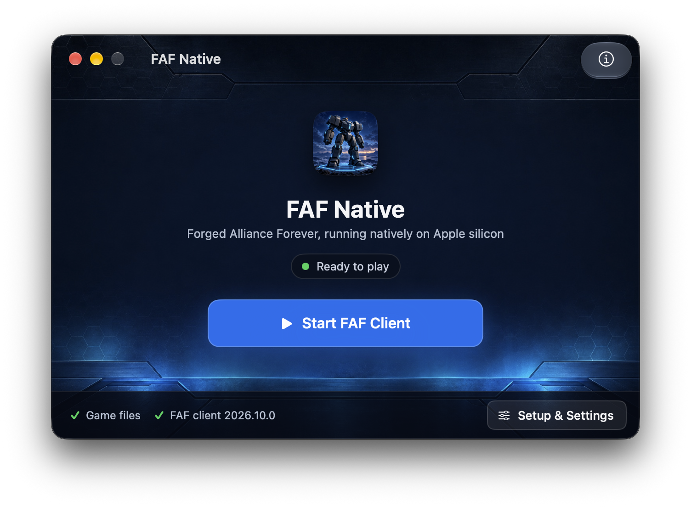
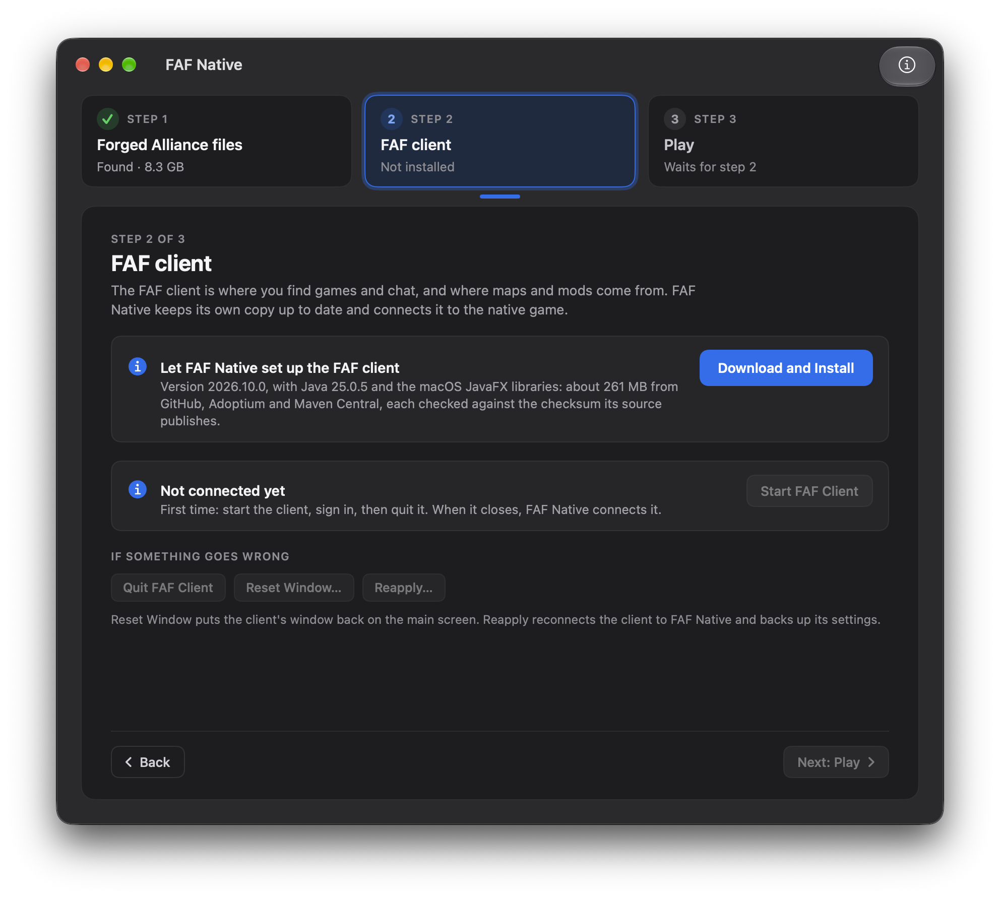
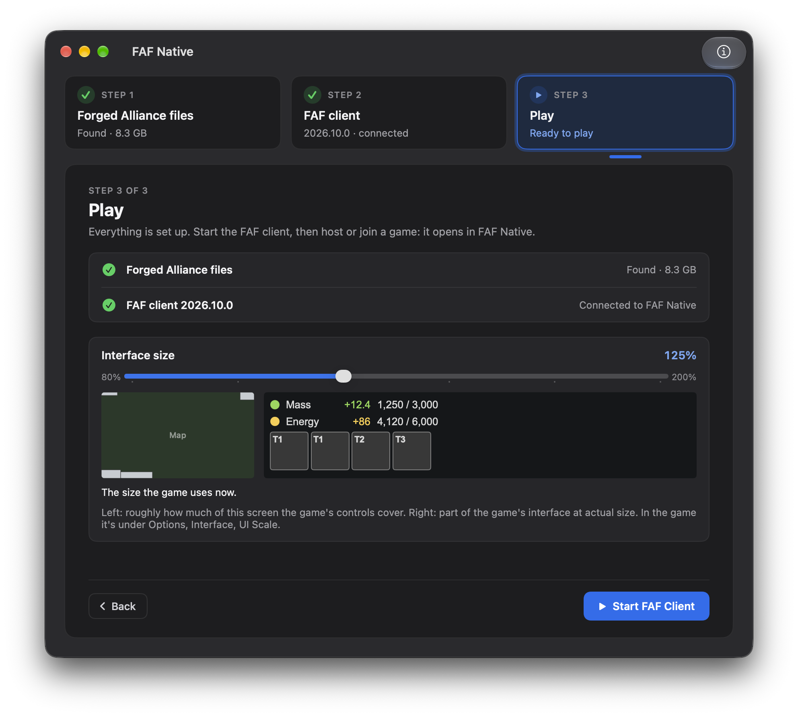

# FAF Native

Forged Alliance Forever on Macs with Apple silicon, running natively. The game is [faf-re](https://github.com/Draiget/faf-re), the rebuilt *Supreme Commander: Forged Alliance* engine, compiled for Apple silicon: no Windows, Wine or game emulation. It plays online FAF games in sync with players on Windows and Linux.

<p align="center"></p>

FAF Native is one app:

- **the game**, with every library it needs inside the app;
- **a setup window** that finds your Forged Alliance files, downloads and sets up the FAF client, and connects the two;
- **the launcher** the FAF client starts games through, in place of the Windows game.

## What you need

- A Mac with Apple silicon and macOS 14 or later.
- Your own copy of *Supreme Commander: Forged Alliance* (Steam, GOG or disc): its installed files, for example in a CrossOver or Wine bottle, or a folder copied from a Windows PC.
- A [FAF](https://faforever.com) account.

## Download

**[Download FAF Native](https://github.com/ScottiDoes/faf-re-mac/releases/latest/download/FAF-Native.dmg)**. It's signed with a Developer ID and notarized by Apple, so it opens like any other app. Open the disk image, drag FAF Native onto Applications, then open it from there.

To update, download the newest one and replace the app. Earlier versions and their notes are under [Releases](https://github.com/ScottiDoes/faf-re-mac/releases).

## Build it yourself

You also need Apple's Command Line Tools (`xcode-select --install` in Terminal) or Xcode, and about 4 GB of free space. In Terminal:

```sh
zsh -c "$(curl -fsSL https://raw.githubusercontent.com/ScottiDoes/faf-re-mac/macos-native/macos/get.sh)"
```

This:

1. clones this repository into `~/faf-re-mac`;
2. builds the app with [`macos/build_app.sh`](../macos/build_app.sh). The first time, it downloads about 520 MB of dependencies, each checked against a pinned SHA-256, and asks you to accept the Vulkan SDK's licences. It then compiles for a while (7 minutes on an M2 Max);
3. copies `FAF Native.app` into Applications.

Then open FAF Native from Applications. To update, run the same command again: it pulls the newest source and rebuilds only what changed.

You can read [the script](../macos/get.sh) before running it. Options are set in front of the command, for example `FAF_NATIVE_APPLICATIONS=~/Applications zsh -c "$(curl ...)"`:

| Variable | Effect |
|---|---|
| `FAF_NATIVE_SOURCE=<dir>` | where the source goes (default `~/faf-re-mac`) |
| `FAF_NATIVE_APPLICATIONS=<dir>` | where the app goes (default `/Applications`); `none` only builds it |
| `ACCEPT_VULKAN_SDK_LICENSE=1` | accept the Vulkan SDK's licences without being asked |
| `SIGN_IDENTITY=<identity>` | sign with your own certificate instead of ad hoc |

All of `build_app.sh`'s options work here too. They're listed in [macos/BUILDING.md](../macos/BUILDING.md).

### By hand

```sh
git clone -b macos-native https://github.com/ScottiDoes/faf-re-mac.git
faf-re-mac/macos/build_app.sh
```

The app lands in `faf-re-mac/build/dist`, with a disk image and a zip of it beside it.

## First run

The window takes you through three steps:

1. **Forged Alliance files.** FAF Native looks for your copy. If it doesn't find it, choose its folder. It's used where it is, or copied into the app's own folder.
2. **FAF client.** **Download and Install** gets the newest FAF client. Start it, sign in once, then quit it: FAF Native connects the client to the native game, keeping a backup of the client's settings. The client's Java runtime runs under Rosetta, which the window installs if needed (macOS asks for an administrator password). Only the game is native.
3. **Play.** Choose the game's interface size, then start the FAF client and host or join games as usual. They open in FAF Native.

<p align="center">


</p>

From then on, FAF Native opens the small window above. **Setup & Settings** brings back the full one.

## Known issues

- FAF Beta Balance games go out of sync: that featured mod's game executable already carries changes our engine doesn't have yet. Regular FAF games are not affected.

## Where things are

| | |
|---|---|
| The app's data (the FAF client, settings, a copied game) | `~/Library/Application Support/FAF Native` |
| Logs (`launch.log`, `game-output.log`) | `~/Library/Logs/FAF Native` |
| The FAF client's own data (maps, mods, replays, `client.prefs`) | `~/.faforever` |
| The source and the build, if you built it | `~/faf-re-mac` |

To remove FAF Native, delete the app, `~/Library/Application Support/FAF Native`, `~/Library/Logs/FAF Native` and, if you built it, `~/faf-re-mac`. `~/.faforever` belongs to the FAF client. FAF Native's backups of the client's settings are kept there as `client.prefs.before-faf-native-<time>`.

## Sharing a build

The download opens on any Mac. An app you build yourself is signed ad hoc, so it runs on your Mac, but macOS blocks its first launch on another one. [Sharing the app](../macos/BUILDING.md#sharing-the-app) covers **Open Anyway**, and signing and notarizing with your own Developer ID ([`macos/release.sh`](../macos/release.sh)), which can also publish the result as a GitHub release.

## About

FAF Native is built on [faf-re](https://github.com/Draiget/faf-re) by Draiget.

FAF Native isn't affiliated with Forged Alliance Forever, or with the original publisher or developer of *Supreme Commander: Forged Alliance*. It includes no game content: you need your own copy of the game.

How the port works, and how to work on it: [macos/BUILDING.md](../macos/BUILDING.md), [the platform layer](../src/platform/posix/README.md) and [macos/docs](../macos/docs).

The Mac build files in [macos/](../macos) are MIT licensed: [macos/LICENSE](../macos/LICENSE).
